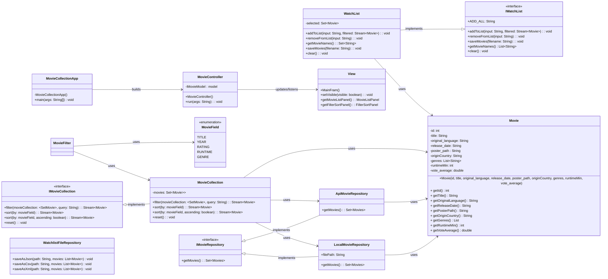

Product Proposal — Movie Collection Planner

----------------------------------------------------------------------------------------------------------------------------------------------------------------------------------------------------------------
## 1. What are we building?
----------------------------------------------------------------------------------------------------------------------------------------------------------------------------------------------------------------

    We are building a Java Swing application that manages a collection of movies. 
    Users will be able to browse movies, search/filter/sort them, build custom watchlists, and save those watchlists to a file.
    
        The application will follows:
        * OOD principles 
        * MVC architecture to separate concerns. 
        * TDD + JUnit testing for all code - TDD will be used for implementation
        * Javadoc + README + evolving UML - keep the documentation and code in sync as design evolves

----------------------------------------------------------------------------------------------------------------------------------------------------------------------------------------------------------------
## 2. Required features
----------------------------------------------------------------------------------------------------------------------------------------------------------------------------------------------------------------

These are the required features we will implement:

    1. Swing GUI
        > This will be responsible for displaying a collection of movies.
        > It will have panels for watchlist management (e.g. - filter, sort, reset)
        
    2. View all movies in a logical order
        > Display all movies in a logical order (e.g. - lexicographical - NATURAL, by rating, etc.) # might need a local database as a seed to see everything; pull missing in via API
    
    3. Build watchlists from the collection using criteria
        > Users can build watchlists using filters for at least Genre and Rating
        
    4. Save watchlists to a file format such as JSON, with CSV as optional
        > Users can export watchlists to JSON (default) or CSV (optional)
        
----------------------------------------------------------------------------------------------------------------------------------------------------------------------------------------------------------------
## 3. Additional features
----------------------------------------------------------------------------------------------------------------------------------------------------------------------------------------------------------------

To exceed expectations (based on group size requirements), we will implement the following features.

    1. Be able to search for items in the collection --> Search movies by title (substring match)
    2. Be able to sort items in the collection --> Sort movies by Title, Year, Rating
    3. Be able to filter items in the collection --> Filter by Genre, Rating, Year
    
    Fallbacks
        1. If your items have numeric data, be able to display them in a graph. # bar graph showing # of movies by year
        2. Have your original item list come from an online API/online access # page through API and create starter database from API

----------------------------------------------------------------------------------------------------------------------------------------------------------------------------------------------------------------
## 4. Stretch Goals
----------------------------------------------------------------------------------------------------------------------------------------------------------------------------------------------------------------
    1. API integration
    2. Movie poster display
    3. Possible future extension to support TV shows

----------------------------------------------------------------------------------------------------------------------------------------------------------------------------------------------------------------
## 5. Initial Design (Special emphasis should be placed on how you plan to break it up)
----------------------------------------------------------------------------------------------------------------------------------------------------------------------------------------------------------------

We will follow MVC to ensure separation of concerns and keep the code clean. This separation improves maintainability, testability, and allows team members to work on different components in parallel. and make code maintenance (e.g. - changes) more difficult.

<mark>Model - Implements filtering, sorting, searching and list-building logic.</mark>

Responsible for the business logic of the application.

    1. Movie - represents a single movie object with attributes such as title, genre, year and rating. --> data
    2. MovieCollection - represents the full collection of movies currently available in the application. Provides operations like filter and sort. --> full data set and operations
    3. Watchlist - represents a user-defined subset of movies selected from the collection. Allows adding, removing and retrieving of movies for persistence and display. --> user selected subset
    4. MovieFilter - Contains filtering logic for movies based on criteria such as genre, rating and year. Keeps filtering logic separate from other model responsibilities. --> dedicated to filtering
    5. MovieSorter - Contains the sorting logic for movies based on fields such as title, year or rating. --> dedicated to sorting

<mark>View - Owns the Swing GUI only</mark>

Responsible for showing panels/buttons, search box and results display. It will not contain business logic; all processing is handled by the controller and model.

    1. MainFrame # main application widnow that contains and organizes all UI panels.
    2. MovieListPanel # displays the current list of movies to the user. Updates based on results from filter and sort operations.
    3. FilterSortPanel # provides UI controls for filtering and sorting. Captures users input and forwards it to the controller for orchestration.
    4. Watchlist # Displays the user's current watchlist. Allows adding/removing from the watchlist.

<mark>Controller - bridge between view and model.</mark>

Main orchestrator for the application. Receives user input from GUI, delegates operations to model, updates view with results.

    1. MovieController # acts as the intermediary between the view and the model. Handles user actions and invokes the model operations and updates the view as needed. 

<mark>Model - Data access layer</mark>

The following is responsible for the API and file logic (I/O). Package.

    1. IMovieRepository (interface) - Defines the contract for retrieving movie data from a data source. This will allow abstraction so the concrete implementation can be swapped out.
    2. LocalMovieRepository - Concrete implementation for retrieving movie data from a local data source (e.g. - JSON file)
    3. ApiMovieRepository - Concrete implementation for retrieving movie data from an API data source (e.g. - TheMovieDatabase API endpoint(s))
    4. WatchlistFileRepository - Responsible for persisting watchlists to disk as JSON or CSV.

In summary...
    * View --> UI only
    * Controller --> coordination
    * Model --> business logic
    * *Repository --> data access (I/O) abstraction

##### Data Flow

For browsing/searching/filtering, app checks local first. If needed, it can query the API.
The controller asks the repo for movies; the repo decides whether to use local or remote API.
The rest of the app doesn't need to know which source was used. 

Use interfaces around data access so that file and API sources can be used interchangeably without having to modify the rest of the application.

#### Work breakdown

The team will use feature branches, pull requests and team reviews before merging to main.
We will follow a feature-based development approach using GitHub:
Workflow
1. Create feature branch
2. Implement feature
3. Submit pull request
4. Team review // facilitates learning and refinement
5. Merge to main // this is our equivalent of "production code"

This follows GitHub practices for collaborate development.
The repo is backed up periodically with history for disaster recovery.
Team is up to speed on our branch strategy.

<mark>Suggested ownership:</mark>
* Member 1: model; filter/sort
* Member 2: model; search logic, save/load
* Member 3: Controller wiring
* Everyone: JUnit tests, Javadocs, README/manual, UML alignment - all coordinated via PR review

<mark>Alternate breakdown</mark>

<u>Work Distribution</u>
<b>Developer</b>
Model classes (MovieCollection, Movie, Watchlist)
<b>Developer</b>
Filtering and sorting logic
<b>Developer</b>
File handling (save)
<b>Developer</b>
API integration (if implemented)
<b>Developer</b>
* Get collection
  <b>Developer</b>
* Get movie posters
  <b>Developer || Everyone</b>
  GUI implementation (Swing)
* Controller integration
  <b>Everyone</b>
* Junit testing
* Documentation (Javadoc, README)
* UML updates
* Code Reviews

----------------------------------------------------------------------------------------------------------------------------------------------------------------------------------------------------------------
## 6. Initial UML Design (High-Level)
----------------------------------------------------------------------------------------------------------------------------------------------------------------------------------------------------------------

----------------------------------------------------------------------------------------------------------------------------------------------------------------------------------------------------------------
### 7. What is your teams timeline and major check-in points?
----------------------------------------------------------------------------------------------------------------------------------------------------------------------------------------------------------------
Roadmap
Week 1 - Plan/Setup
* Finalize idea and scope
* Create GitHub repo + add team & professor/TA as collaborators - DONE
* Initial UML diagram
* Implement model classes

Week 2 - Core Features
* Implement collection mgmt
* Filter, sort and search logic
* Begin controller layer

Week 3 - GUI integration
* Build Swing UX
* Integrate Swing UX with controller
* Implement save feature

Week 4 - Feature Completion
* Implement any outstanding features
* Polish UI
* Debugging
* Documentation (e.g. - README, manual, final UML)

Week 5 - Finalization
* Documentation (e.g. - README, manual, final UML)
* Demo prep

Checkpoints
* Team will meet each weekend + adhoc.

----------------------------------------------------------------------------------------------------------------------------------------------------------------------------------------------------------------
### Justifications
----------------------------------------------------------------------------------------------------------------------------------------------------------------------------------------------------------------

    1. MVC - separates GUI concerns from business logic and orchestration. This directly improves maintainability, testability and makes it easier for team members to work in parallel.
    2. Repository classes - Dedicated to I/O operations so we can support local or API data sources or both without changing the rest of the design. Might be able to define factory methods to hide implementation to achieve this.
    3. Getting data from the API - We would like to reat the API as a data source that can be queried. We check local data first and if needed, we fetch rleevant results from the API rather than loading everything upfront into memory.
        - Local first fetch is better design as it saves network bandwidth and reduces the likelihood of encountering network-related failure modes. API would just be a fallback. Lazy fetching.
    4. MovieCollection vs Watchlist - MovieCollect represents the full dataset currently in memory while the latter represents a user-defined subset.
        - Flow: 
            1. User searches/filters/sorts
            2. MovieController calls MovieRepository
            3. Repository returns a list of movies
            4. That list becomes the MovieCollection (working set)
            5. User selects movies for addition to the Watchlist
    5. Modular design
        1. MovieFilter and MovieSorter handle their respective operations. Easier maintenance.
