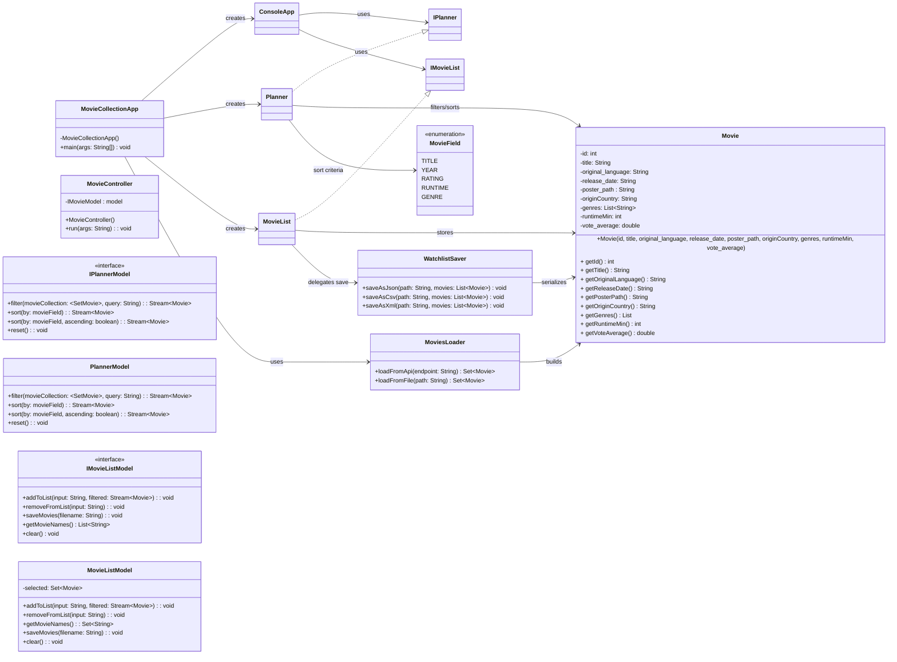

# Surface-Level UML (Initial)

This is a high-level UML draft for the `cs5004_final_project`, using the same overall shape as `BoardGameArenaPlanner` (launcher, app/controller, interfaces, implementations, model, loader/saver).

