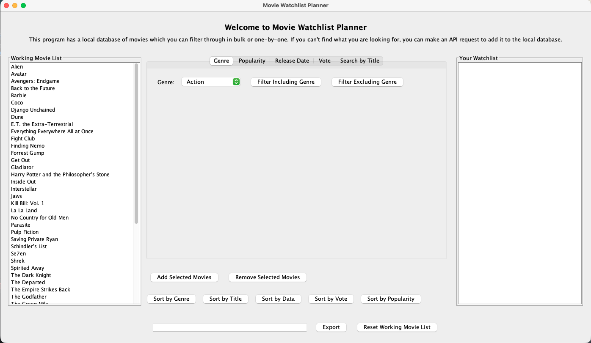
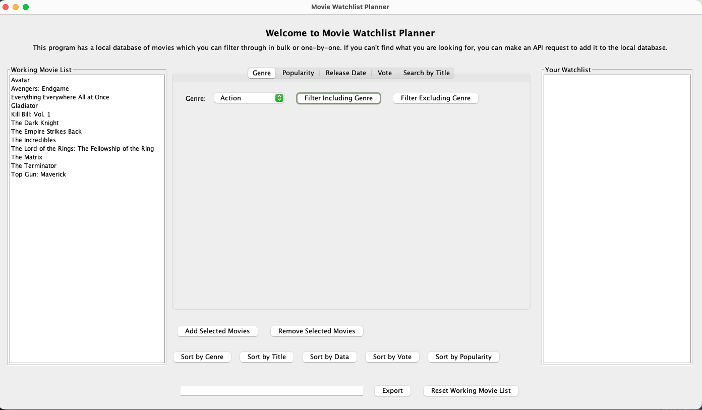
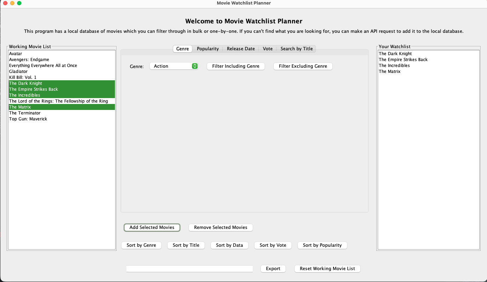
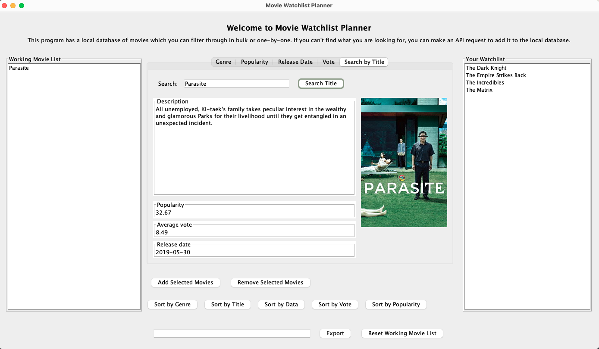
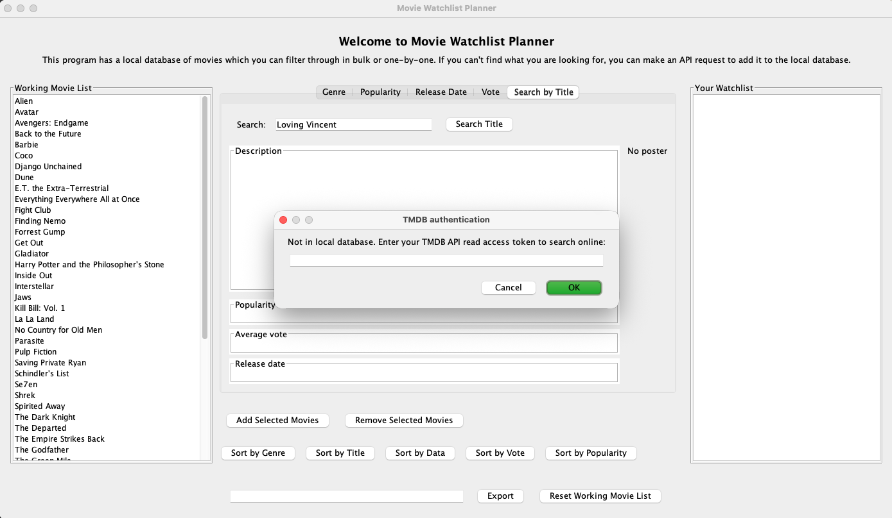
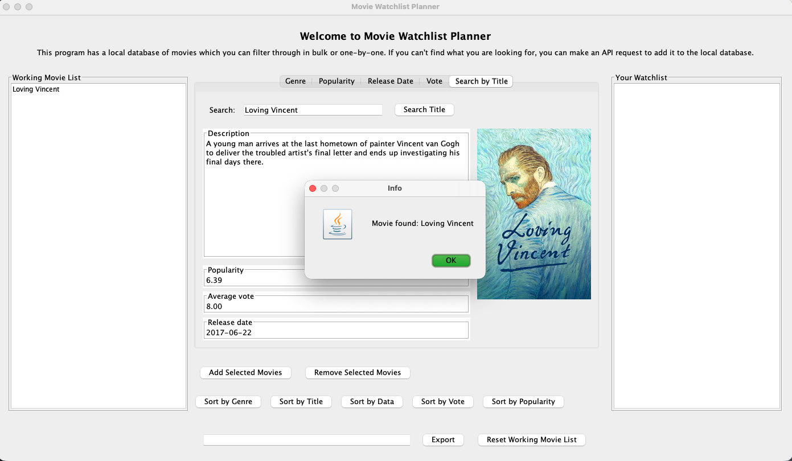

# Movie Watchlist Planner: User Manual

Movie Watchlist Planner lets you filter, sort, and search a catalog of movies, build your own watchlist, and export it.

To launch the program, run `./gradlew run` from the project root, or run the `main` method in [MovieWatchListPlanner.java](../src/main/java/MovieWatchListPlanner.java).

## The main screen

The screen has three panels:

- **Working Movie List** (left): every movie currently loaded. The app ships with 50 well-known films, and you can add more with a TMDB lookup (covered below).
- **Filter tabs** (center): Genre, Popularity, Release Date, Vote, and Search by Title. Each tab narrows the working list.
- **Your Watchlist** (right): the movies you've picked.

## Filtering

Pick a genre and press **Filter Including Genre** to keep only movies in that genre, or **Filter Excluding Genre** to remove them. Here the list is filtered to Action movies:

Filters stack, so you can keep narrowing the list with the Popularity, Release Date, and Vote tabs. Press **Reset Working Movie List** to clear all filters. Resetting leaves your watchlist alone.

Use the sort buttons to order both lists by genre, title, release date, vote, or popularity.

## Building a watchlist

Select one or more movies in the working list and press **Add Selected Movies**. To take movies off your watchlist, select them there and press **Remove Selected Movies**.

## Searching by title

Open the **Search by Title** tab and enter a title. If the movie is in the catalog, its description, poster, popularity, average vote, and release date are shown.

## Looking up movies outside the catalog

If a title isn't in the catalog, the program asks for your TMDB API read access token. You can create one for free at [themoviedb.org](https://www.themoviedb.org/settings/api).

The program then searches TMDB. If it finds the movie, it adds it to the catalog so you can put it on your watchlist like any other movie.

## Exporting

Type a file name in the box at the bottom of the window and press **Export** to save your watchlist as a JSON file.
