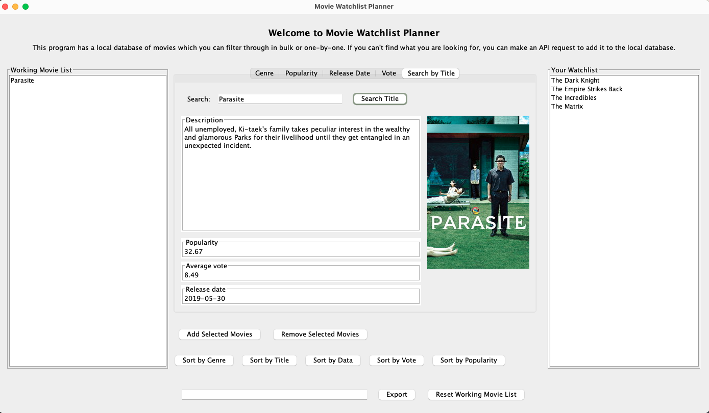
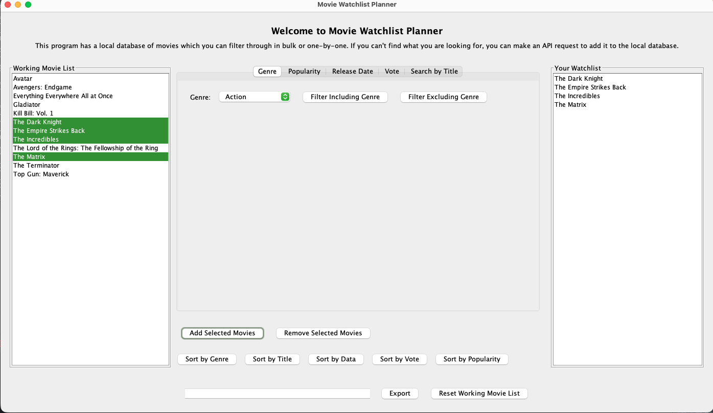

# Movie Watchlist Planner

A Java/Swing desktop app for browsing a movie catalog, filtering and sorting titles, and building a watchlist you can export. Movies that aren't in the local catalog can be looked up live through the [TMDB](https://www.themoviedb.org) API.

Final project for CS 5004 (Object-Oriented Design) at Northeastern University.



## Features

- **Filter** by genre (include or exclude), popularity, average vote, and release date. Filters stack, so you can narrow the list step by step.
- **Sort** both lists by title, genre, release date, vote, or popularity.
- **Search** by title, with the poster, description, and stats shown for the match.
- **Live TMDB lookup** when a title isn't in the local catalog. The app asks for your TMDB token, so no key is stored in the code.
- **Build a watchlist** and export it to JSON.



## Tech

- **Java 17**, **Swing** for the GUI
- **MVC architecture**: `model` (catalog, filters, watchlist), `view` (Swing UI behind an `IView` interface), `controller` (wires them together)
- **REST API integration** with TMDB using `java.net.http.HttpClient`
- **Jackson** for JSON parsing
- **JUnit 5** tests for the filters, sorting, catalog loading, controller, and view, with stubs so tests don't need a network connection or API key
- **Gradle** build

## Running it

Requires JDK 17 (the Gradle 7.4 wrapper doesn't support newer JDKs).

```bash
./gradlew run      # launch the app
./gradlew test     # run the test suite
```

The app ships with a catalog of 50 well-known films in `data/movies.json`. To look up movies outside the catalog, you'll need a free TMDB API read access token from [themoviedb.org](https://www.themoviedb.org/settings/api).

## Docs

- [User manual](Manual/README.md): walkthrough with screenshots
- [Design documents](DesignDocuments/README.md): proposal and UML

## Team

- Bailey Jung ([@jungbail](https://github.com/jungbail))
- Ellie Smith ([@smithelie](https://github.com/smithelie))
- Maricarmen Rodriguez ([@maricarmencodes](https://github.com/maricarmencodes))

---

This product uses the TMDB API but is not endorsed or certified by TMDB.
